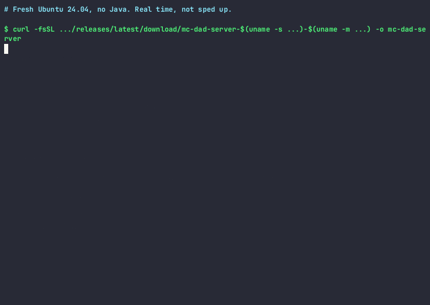

# MC Dad Server

[](https://github.com/KevinTCoughlin/mc-dad-server/actions/workflows/ci.yml)
[](https://github.com/KevinTCoughlin/mc-dad-server/actions/workflows/release.yml)
[](https://github.com/KevinTCoughlin/mc-dad-server/actions/workflows/nightly.yml)
[](https://github.com/KevinTCoughlin/mc-dad-server/actions/workflows/container.yml)
[](https://goreportcard.com/report/github.com/KevinTCoughlin/mc-dad-server)
[](https://opensource.org/licenses/MIT)

**Minecraft server in about two minutes — for busy dads who just want their kids to play.**

One binary, zero fuss. Run `mc-dad-server install` for a bare-metal server, or use the included Containerfile for Docker/Podman — with Bedrock cross-play, Parkour courses, and tuned configs out of the box.

## Requirements

This release runs **Paper 26.3** on **Java 25** (Eclipse Temurin). The installer reads `java --version`. When Java is missing or older than 25, it says so and installs Temurin 25.

Java 21 and Minecraft 1.21 stay on the previous release, [v0.2.0](https://github.com/KevinTCoughlin/mc-dad-server/releases/tag/v0.2.0). That release installs Temurin 21. It does not run Paper 26.3.

The container image is `eclipse-temurin:25-jre-alpine`. There is no Java 21 server image.

## Quick Start

You need `curl` and an account that can use `sudo`. The installer runs
`sudo` to install Java 25, `jq` and `screen`, the systemd service, firewall
rules and playit.gg, so it may ask for your password.

```bash
# 1. Download the binary for your platform
curl -fsSL https://github.com/KevinTCoughlin/mc-dad-server/releases/latest/download/mc-dad-server-$(uname -s | tr A-Z a-z)-$(uname -m | sed 's/x86_64/amd64/;s/aarch64/arm64/') -o mc-dad-server
chmod +x mc-dad-server

# 2. Install Java, Paper, plugins and configs (about 1 minute)
./mc-dad-server install

# 3. Start the server (first boot takes 40-60 seconds)
./mc-dad-server start
```

`install` does not start the server; `start` does. The server is ready when
the console (`screen -r minecraft`, detach with Ctrl+A then D) shows
`Done (...)! For help, type "help"`. Then connect to `localhost:25565`.

The examples below call `mc-dad-server` without `./`. To do the same, move
it onto your PATH: `sudo install -m 755 mc-dad-server /usr/local/bin/`.



The recording is real time, not sped up: a fresh Ubuntu 24.04 machine with
no Java, on a fast connection. From the first command to the server
accepting connections took 118 seconds; an earlier run took 98. Most of it is
the Java download and Paper's first world generation, so a slower connection
or machine takes longer.

Or via `go install` (then run steps 2 and 3 without `./`):

```bash
go install github.com/KevinTCoughlin/mc-dad-server/cmd/mc-dad-server@latest
mc-dad-server install
mc-dad-server start
```

## Batteries Included

Every Paper server install comes loaded with:

| Plugin | What It Does |
|--------|-------------|
| **Geyser + Floodgate** | Kids on iPad, Switch, and phones connect to your Java server. No second account needed. |
| **Parkour** | Build obstacle courses. Checkpoints, leaderboards, death counters. Kids go nuts for this. |
| **WorldEdit** | Fast course building. `//set`, `//stack`, `//copy` — build a parkour map in minutes. |
| **Multiverse-Core** | Separate worlds for parkour, creative, survival. Keep things organized. |
| **ChatSentry** | Configurable chat filter with blocked words list. Kid-safe by default. |

Plus battle-tested PaperMC configs (bukkit.yml, spigot.yml, paper-global.yml) tuned from a real production server.

## What It Does

- Installs Adoptium Temurin Java 25+ (required by Paper 26.3)
- Downloads Paper 26.3, build 233 or newer (optimized, fast, plugin-ready)
- Deploys tuned server configs from a battle-tested PaperMC server
- Downloads and installs plugins (Geyser, Parkour, WorldEdit, Multiverse, ChatSentry)
- Sets up start script with GC selection (G1GC or ZGC)
- Sets up auto-start on boot (systemd or launchd)
- Daily automatic backups with rotation
- Opens firewall ports for Java (25565) and Bedrock (19132)
- Optional playit.gg tunnel — **no port forwarding needed**
- Optional [TypeScript/JS scripting sidecar](docs/scripting.md) for custom automation (`--experimental-bun`)

## Works On

| Platform | Status |
|----------|--------|
| Ubuntu/Debian | Fully supported |
| Fedora/RHEL | Fully supported |
| Arch Linux | Fully supported |
| macOS | Fully supported |
| Windows (x64/ARM64) | Fully supported |
| WSL2 (Windows) | Fully supported |
| Docker / Podman | Fully supported (`--mode container`) |
| Raspberry Pi | Works (use `--memory 1G`) |

## Options

```bash
mc-dad-server install \
  --type paper \
  --memory 4G \
  --port 25565 \
  --difficulty normal \
  --gamemode survival \
  --players 20 \
  --gc g1gc \
  --motd "Our Family Server"
```

| Flag | Default | Description |
|------|---------|-------------|
| `--edition` | `java` | `java` or `bedrock` |
| `--type` | `paper` | `paper`, `fabric`, or `vanilla` |
| `--dir` | `~/minecraft-server` | Install location |
| `--port` | `25565` | Server port |
| `--memory` | `2G` | RAM allocation |
| `--difficulty` | `normal` | `peaceful`, `easy`, `normal`, `hard` |
| `--gamemode` | `survival` | `survival`, `creative`, `adventure` |
| `--players` | `20` | Max player count |
| `--gc` | `g1gc` | `g1gc` (Aikar's flags) or `zgc` (low latency) |
| `--motd` | `Dads Minecraft Server` | Message of the day |
| `--playit` | `true` | Set up playit.gg tunnel (`--no-playit` to skip) |
| `--chat-filter` | `true` | Install chat filter plugin (`--no-chat-filter` to skip) |
| `--mc-version` | `26.3` | Minecraft version. `latest` stays on the newest stable release at or below 26.3. `26.4` and snapshots are refused. |
| `--experimental-bun` | `false` | Enable [TypeScript/JS scripting sidecar](docs/scripting.md) |

### Global Flags

| Flag | Default | Description |
|------|---------|-------------|
| `--dir` | `~/minecraft-server` | Server directory |
| `--session` | `minecraft` | Screen session / container name |
| `--mode` | `auto` | `auto`, `screen`, or `container` — how to manage the server process |

## Daily Commands

```bash
# Start the server (runs in background)
mc-dad-server start

# Check if it's running
mc-dad-server status

# View the server console (screen mode)
screen -r minecraft
# (Press Ctrl+A then D to detach)

# Stop the server (graceful 30s countdown)
mc-dad-server stop

# Manual backup
mc-dad-server backup
```

## Container Deployment

Run the server in Docker or Podman instead of a bare-metal screen session. The Containerfile uses Eclipse Temurin 25 JRE on Alpine Linux and includes Geyser 2.12.1, Floodgate 2.2.5, Parkour 7.2.8, Multiverse-Core 5.8.2, and WorldEdit 7.4.6. Container builds pin those plugin releases and Paper 26.3 (build 233 or newer). `MC_VERSION=latest` does not follow a newer Paper line. Override `MC_VERSION` at build time only after checking [plugin compatibility](docs/paper-compatibility.md).

```bash
# Build and start with Podman Compose
podman compose up -d

# Or with Docker Compose
docker compose up -d

# CLI auto-detects container mode
mc-dad-server status              # auto-detects running container
mc-dad-server --mode container status   # force container mode

# Manage the container
mc-dad-server stop                # graceful shutdown with player countdown
podman logs -f minecraft          # follow server logs
```

### Environment Variables

| Variable | Default | Description |
|----------|---------|-------------|
| `MEMORY` | `2G` | JVM heap size |
| `GC_TYPE` | `g1gc` | `g1gc` (Aikar's flags) or `zgc` |
| `PORT` | `25565` | Minecraft server port |
| `RCON_PORT` | `25575` | RCON port (localhost only) |
| `RCON_PASSWORD` | required | RCON password (generate one with `openssl rand -base64 24`) |
| `MC_VERSION` | `26.3` | Minecraft version to download. Snapshots and 26.4 are refused. |

### Systemd Integration (Quadlet)

For always-on servers, install the Quadlet unit for rootless Podman with systemd:

```bash
mkdir -p ~/.config/containers/systemd
cp quadlet/minecraft.container ~/.config/containers/systemd/
systemctl --user daemon-reload
systemctl --user start minecraft
```

See `compose.yml` for volume mounts, port mappings, and security hardening (cap_drop, no-new-privileges, memory limits).

For release and smoke-test readiness, see the [operational quality checklist](docs/operational-quality.md).

## Bedrock Cross-Play (iPad, Switch, Phone)

Your kids on Bedrock Edition connect to the same server as Java players. No extra accounts, no extra servers.

- **Java players:** connect to `your-ip:25565` as usual
- **Bedrock players:** connect to `your-ip` on port `19132`

Geyser handles the translation. Floodgate means they don't need a Java Minecraft account. Kids on Switch, iPad, phone, Windows 10 — they all just connect.

## Parkour

After your first server boot, set up the parkour world:

```bash
mc-dad-server setup-parkour
```

Then in-game:

```
/mv tp parkour          # teleport to parkour world
/pa setlobby            # set lobby at your position
/pa create MyCourse     # start building a course
/pa checkpoint          # add checkpoint where you stand
/pa finish              # set the finish line
/pa ready MyCourse      # open it up for players
```

### Pre-built Maps

Install 5 curated parkour maps from [Hielke Maps](https://hielkemaps.com) — no building required. Maps: Parkour Spiral, Spiral 3, Volcano, Pyramid, Paradise.

### Auto Map Rotation

Keep things fresh — rotate the featured parkour map:

```bash
# Manual rotation
mc-dad-server rotate-parkour

# Automate with cron (every 4 hours)
0 */4 * * * mc-dad-server rotate-parkour >> ~/minecraft-server/logs/rotation.log 2>&1
```

When a map rotates, all players get a broadcast and are teleported to the new featured map. See [docs/parkour.md](docs/parkour.md) for full details.

## Support

MC Dad Server is **free and fully functional** — no features are locked behind a paywall.

If you find it useful, you can support development:

[](https://github.com/sponsors/KevinTCoughlin)
[](https://ko-fi.com/kevintcoughlin)

You can also purchase a license — licensed users get clean output without nag messages and a "Licensed to [name]" badge.

```bash
mc-dad-server activate-license --key YOUR-LICENSE-KEY
```

See [docs/license.md](docs/license.md) for license management documentation.


## Multiplayer Without Port Forwarding

The installer optionally sets up [playit.gg](https://playit.gg), which creates a tunnel so your kids' friends can connect without you touching your router.

1. Run `playit` after install
2. Claim your agent at the link shown
3. Create a Minecraft Java tunnel -> `localhost:25565`
4. Share the address with friends' parents

No port forwarding. No exposing your home IP. Easy.

## Building from Source

**Quickest path:** Open in [GitHub Codespaces](https://github.com/codespaces) — the dev container includes Go 1.26, Eclipse Temurin 25, Kotlin, and all dev tools pre-configured. The repo requires Go 1.26 (`go1.26.5`).

**Local prerequisites:** Go `1.26.5+`, [just](https://github.com/casey/just#installation), and optionally Eclipse Temurin 25 and Kotlin for plugin work. This repo has no Gradle or Maven module; the devcontainer Java feature is Temurin 25, which is the toolchain any plugin code would compile with. Run `just tools` to install the Go dev tools (golangci-lint, gofumpt, goreleaser).

```bash
git clone https://github.com/KevinTCoughlin/mc-dad-server.git
cd mc-dad-server
just tools       # install dev tools
just build       # build binary
just test        # run tests
just check       # fmt + vet + lint + test
just build-all   # cross-compile all targets (go build matrix)

# Container
just container-build   # build container image
just container-up      # start with Podman Compose
```

Paper 26 stores all dimensions under the persistent `world` directory. Do not
mount `world_nether` or `world_the_end` separately. Before updating an older
deployment, stop the server and back up every world volume
(`podman volume export`). Do not run `compose down -v`.

Two steps are needed when an existing volume moves to this image:

1. **Ownership.** The image now runs as UID/GID 1000 (earlier images used
   100:101). Re-own the volumes once, for example
   `podman unshare chown -R 1000:1000 <volume path>` for the worlds, plugins,
   logs and backups volumes. Otherwise Paper fails with
   `AccessDeniedException: ./world/session.lock`.
2. **World location.** The worlds volume is now mounted at `/minecraft/worlds`
   and passed to Paper as `--world-container`, so the world lives at
   `worlds/<level-name>` inside the volume. Paper renames the whole world
   directory during format upgrades; when the volume itself was the world
   (mounted at `/minecraft/world`) that rename failed with
   `AtomicMoveNotSupportedException ... Cross-device link`. On the first start
   with the new mount, the entrypoint moves a world found at the volume root
   into `worlds/<level-name>`, inside the same volume. Update any compose
   file or quadlet you maintain yourself to the new mount path.

The image only seeds the plugins volume when it is empty. After an upgrade,
copy the new jars from `/minecraft/plugins` in the image over the ones in the
volume; configs can stay.

The entrypoint exits if Java fails, and the container health check tests the
Java listener rather than matching its own process arguments. AppCDS training
settings are replaced with the configuration template before the image is used.

See [CONTRIBUTING.md](CONTRIBUTING.md) for the full development guide.

## FAQ

**Q: How much RAM do I need?**
2GB is fine for 2-5 players. 4GB for 5-10. 8GB if the kids go crazy with mods.

**Q: G1GC or ZGC?**
G1GC (default) is battle-tested with Aikar's flags. ZGC is newer and lower latency on this Java 25 runtime when the machine has 8GB or more. Try `--gc zgc` if you want to experiment.

**Q: Can my kids on iPad/Switch join?**
Yes! Geyser + Floodgate is installed by default. Bedrock players connect on port 19132. No Java account needed.

**Q: Can my kids' friends connect from their house?**
Yes! Use playit.gg (included) or forward port 25565 on your router. For Bedrock friends, also forward 19132/udp.

**Q: What's Paper MC?**
It's Minecraft but faster. Same game, better performance, supports plugins.

**Q: Can I add mods?**
Use `--type fabric` for mods (plugins won't install). Paper supports plugins (different ecosystem).

**Q: Is this safe?**
Whitelist is on by default — only players you approve can join. Online mode verifies real Minecraft accounts.

**Q: Can I run this in Docker/Podman?**
Yes! Use `podman compose up -d` (or `docker compose up -d`). The CLI auto-detects container mode, or force it with `--mode container`. See [Container Deployment](#container-deployment).

**Q: What if my server crashes?**
Systemd will auto-restart it. Backups run daily at 4 AM. In container mode, Podman/Docker restarts the container automatically.

**Q: What Java does it install?**
Eclipse Temurin 25. Paper 26.3 requires it, on bare metal and in the `eclipse-temurin:25-jre-alpine` image. If `java --version` is missing or older than 25, the installer explains that and installs Temurin 25. To stay on Java 21 and Minecraft 1.21, use [v0.2.0](https://github.com/KevinTCoughlin/mc-dad-server/releases/tag/v0.2.0).

## Uninstall

```bash
# Stop the server
mc-dad-server stop

# Remove systemd service (Linux)
sudo systemctl disable minecraft
sudo rm /etc/systemd/system/minecraft.service
sudo systemctl daemon-reload

# Remove files
rm -rf ~/minecraft-server

# Remove cron backup
crontab -e  # delete the mc-dad-server line
```

## License

MIT — do whatever you want with it.

## Contributing

PRs welcome! This is for dads, by dads. Keep it simple.
